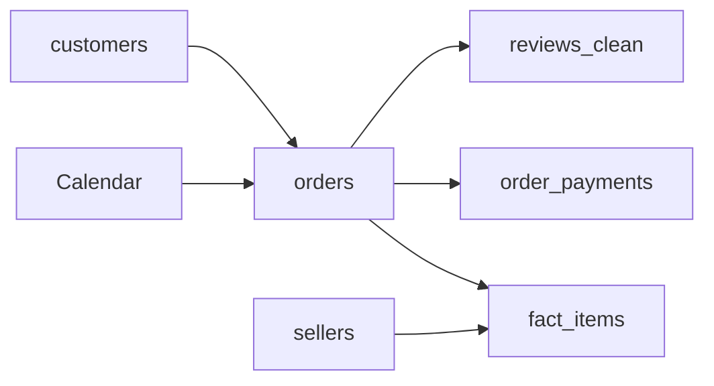

# Power BI Documentation

Documentation for `olist_dashboard.pbix`: data connection, data model, calculated objects, measures, report pages, and maintenance notes.

## Contents

1. [Overview](#1-overview)
2. [Requirements](#2-requirements)
3. [Data Connection](#3-data-connection)
4. [Data Model](#4-data-model)
5. [Calculated Table and Columns](#5-calculated-table-and-columns)
6. [Measures](#6-measures)
7. [Report Pages](#7-report-pages)
8. [Filters Applied](#8-filters-applied)
9. [Design Guidelines](#9-design-guidelines)
10. [Refreshing and Maintenance](#10-refreshing-and-maintenance)
11. [Limitations](#11-limitations)
12. [Troubleshooting](#12-troubleshooting)

---

## 1. Overview

A three-page interactive report built on the PostgreSQL database described in [SQL_DOCUMENTATION.md](SQL_DOCUMENTATION.md).

| Page | Purpose |
|---|---|
| Sales overview | Revenue, orders, average order value, categories, states |
| Delivery and reviews | Delivery speed, lateness, and effect on review scores |
| Sellers, payments and customers | Seller concentration, payment behaviour, repeat customers |

## 2. Requirements

| Item | Detail |
|---|---|
| Power BI Desktop | Windows only |
| PostgreSQL | Database `OLIST_ANALYSIS`, schema `olist`, with views created |
| Npgsql | PostgreSQL driver for Power BI (install with the GAC option, then restart Power BI) |

## 3. Data Connection

| Setting | Value |
|---|---|
| Connector | PostgreSQL database |
| Server | `localhost:5432` |
| Database | `OLIST_ANALYSIS` (upper case) |
| Mode | Import |
| Authentication | Database (PostgreSQL username and password) |

### Tables and views loaded

| Name in model | Source | Type |
|---|---|---|
| `fact_items` | `olist.fact_items` | View |
| `orders` | `olist.orders` | Table |
| `customers` | `olist.customers` | Table |
| `sellers` | `olist.sellers` | Table |
| `reviews_clean` | `olist.reviews_clean` | View |
| `order_payments` | `olist.order_payments` | Table |
| `Calendar` | DAX calculated table | Calculated |

Power BI names imported objects as `olist <name>`. Rename each one by right-clicking it in the Data pane, so the DAX in this document works as written.

Not loaded: `geolocation`, `order_reviews`, `order_items`, `products`, `category_translation` (their content is already inside `fact_items` or not needed for the report).

## 4. Data Model

### 4.1 Relationships

| From (one side) | To (many side) | Cardinality | Filter direction | Active |
|---|---|---|---|---|
| `Calendar[Date]` | `orders[Purchase Date]` | One to many | Single | Yes |
| `customers[customer_id]` | `orders[customer_id]` | One to many | Single | Yes |
| `orders[order_id]` | `fact_items[order_id]` | One to many | Single | Yes |
| `orders[order_id]` | `order_payments[order_id]` | One to many | Single | Yes |
| `orders[order_id]` | `reviews_clean[order_id]` | One to one | Single | Yes |
| `sellers[seller_id]` | `fact_items[seller_id]` | One to many | Single | Yes |

### 4.2 Diagram



Filters flow in the direction of the arrows: a date, customer, or seller selection filters the related order and item rows.

### 4.3 Design notes

- `orders` is the central dimension linking dates, customers, items, payments, and reviews.
- Payments and items are never related to each other directly. Measures on each table are used on their own to avoid inflated totals.
- All relationships use single-direction filtering to avoid ambiguous paths.

## 5. Calculated Table and Columns

### Calendar table

```dax
Calendar = CALENDAR(DATE(2016,9,1), DATE(2018,10,31))
```

Columns on `Calendar`:

```dax
Month = FORMAT('Calendar'[Date], "yyyy-MM")
```
```dax
Year = YEAR('Calendar'[Date])
```

### Columns on `orders`

```dax
Purchase Date = DATEVALUE(orders[order_purchase_timestamp])
```

```dax
Delivery Status =
IF(
  orders[order_status] = "delivered" && NOT ISBLANK(orders[order_delivered_customer_date]),
  IF(orders[order_delivered_customer_date] > orders[order_estimated_delivery_date], "Late", "On time"),
  BLANK()
)
```

```dax
Lateness Bucket =
VAR d = DATEDIFF(orders[order_estimated_delivery_date], orders[order_delivered_customer_date], DAY)
RETURN
IF(
  orders[order_status] <> "delivered" || ISBLANK(orders[order_delivered_customer_date]),
  BLANK(),
  SWITCH(TRUE(),
    d <= 0, "1. On time or early",
    d <= 3, "2. 1-3 days late",
    d <= 7, "3. 4-7 days late",
    "4. Over 7 days late")
)
```

### Column on `fact_items`

`State Full` converts two-letter state codes to full names so the map can geocode them. Data category is set to **State or Province**.

```dax
State Full =
SWITCH(
  fact_items[customer_state],
  "AC","Acre", "AL","Alagoas", "AP","Amapá", "AM","Amazonas",
  "BA","Bahia", "CE","Ceará", "DF","Distrito Federal", "ES","Espírito Santo",
  "GO","Goiás", "MA","Maranhão", "MT","Mato Grosso", "MS","Mato Grosso do Sul",
  "MG","Minas Gerais", "PA","Pará", "PB","Paraíba", "PR","Paraná",
  "PE","Pernambuco", "PI","Piauí", "RJ","Rio de Janeiro", "RN","Rio Grande do Norte",
  "RS","Rio Grande do Sul", "RO","Rondônia", "RR","Roraima", "SC","Santa Catarina",
  "SP","São Paulo", "SE","Sergipe", "TO","Tocantins",
  fact_items[customer_state]
) & ", Brazil"
```

### Column on `order_payments`

```dax
Installment Group =
SWITCH(
  TRUE(),
  order_payments[payment_installments] <= 1, "1. Single payment",
  order_payments[payment_installments] <= 3, "2. 2-3",
  order_payments[payment_installments] <= 6, "3. 4-6",
  order_payments[payment_installments] <= 10, "4. 7-10",
  "5. 11+"
)
```

## 6. Measures

### Sales (stored on `fact_items`)

| Measure | DAX | Format |
|---|---|---|
| Revenue | `SUM(fact_items[price])` | Currency or decimal |
| Orders | `DISTINCTCOUNT(fact_items[order_id])` | Whole number |
| Avg Order Value | `DIVIDE([Revenue], [Orders])` | Decimal |
| Customers | `DISTINCTCOUNT(fact_items[customer_unique_id])` | Whole number |

```dax
Revenue % of Total =
DIVIDE([Revenue], CALCULATE([Revenue], ALL(fact_items[seller_id])))
```

```dax
Repeat Customer % =
VAR t =
  SUMMARIZE(
    FILTER(fact_items, fact_items[order_status] = "delivered"),
    fact_items[customer_unique_id],
    "n", DISTINCTCOUNT(fact_items[order_id])
  )
RETURN
  DIVIDE(COUNTROWS(FILTER(t, [n] > 1)), COUNTROWS(t))
```

`Revenue % of Total` and `Repeat Customer %` use the **Percentage** format.

### Delivery (stored on `orders`)

```dax
Avg Delivery Days =
AVERAGEX(
  FILTER(orders, orders[order_status] = "delivered" && NOT ISBLANK(orders[order_delivered_customer_date])),
  DATEDIFF(orders[order_purchase_timestamp], orders[order_delivered_customer_date], HOUR) / 24
)
```

```dax
Late Delivery % =
DIVIDE(
  COUNTROWS(FILTER(orders, orders[order_status] = "delivered"
    && NOT ISBLANK(orders[order_delivered_customer_date])
    && orders[order_delivered_customer_date] > orders[order_estimated_delivery_date])),
  COUNTROWS(FILTER(orders, orders[order_status] = "delivered"
    && NOT ISBLANK(orders[order_delivered_customer_date])))
)
```

`Late Delivery %` uses the **Percentage** format.

### Reviews (stored on `reviews_clean`)

```dax
Avg Review Score = AVERAGE(reviews_clean[review_score])
```

### Payments (stored on `order_payments`)

```dax
Payment Value = SUM(order_payments[payment_value])
```
```dax
Avg Payment = AVERAGE(order_payments[payment_value])
```

## 7. Report Pages

### Page 1: Sales overview

| Visual | Fields |
|---|---|
| Card | `Revenue` |
| Card | `Orders` |
| Card | `Avg Order Value` |
| Slicer | `Calendar[Year]` |
| Line chart | X: `Calendar[Month]`, Y: `Revenue` |
| Bar chart | Y: `fact_items[category]`, X: `Revenue` (Top 10 by `Revenue`) |
| Filled map | Location: `fact_items[State Full]`, Color saturation: `Revenue` |

### Page 2: Delivery and reviews

| Visual | Fields |
|---|---|
| Card | `Avg Delivery Days` |
| Card | `Late Delivery %` |
| Card | `Avg Review Score` |
| Slicer | `Calendar[Year]` |
| Bar chart | Y: `customers[customer_state]`, X: `Avg Delivery Days` (sorted descending) |
| Column chart | X: `reviews_clean[review_score]`, Y: count (distinct) of `reviews_clean[order_id]` |
| Column chart | X: `orders[Delivery Status]`, Y: `Avg Review Score` |
| Column chart | X: `orders[Lateness Bucket]`, Y: `Avg Review Score` |

Main insight of the page: how late delivery affects satisfaction.

### Page 3: Sellers, payments and customers

| Visual | Fields |
|---|---|
| Card | `Customers` |
| Card | `Repeat Customer %` |
| Slicer | `Calendar[Year]` |
| Table | `fact_items[seller_id]`, `Revenue`, `Orders`, `Revenue % of Total` (Top 10 by `Revenue`) |
| Bar chart | Y: `sellers[seller_state]`, X: `Revenue` |
| Donut chart | Legend: `order_payments[payment_type]`, Values: `Payment Value` |
| Column chart | X: `order_payments[Installment Group]`, Y: `Avg Payment` |

## 8. Filters Applied

| Scope | Filter | Reason |
|---|---|---|
| Revenue visuals and Page 1 | `fact_items[order_status]` excludes `canceled` and `unavailable` | Matches the revenue definition used in SQL |
| Line chart | `Calendar[Date]` between 2016-09-01 and 2018-08-31 | Removes incomplete months |
| Review and delivery charts | Exclude `(Blank)` for delivery status and lateness bucket | Only delivered orders have these values |
| Installments chart | `payment_type` = `credit_card` | Installments apply to cards only |
| Payment donut | Exclude `not_defined` | Rows with no real payment type |
| Top-N visuals | Top 10 by `Revenue` | Readability |

## 9. Design Guidelines

- One theme across all pages (View, Themes).
- Every visual has a clear title. Data labels are on for bar and column charts.
- Each page has a header text box and one sentence stating the main takeaway.
- Slicers are placed in the same position on every page.
- Sort order: bar charts descending by value, time charts ascending by date.

## 10. Refreshing and Maintenance

To open the file on a different machine:

1. Install Power BI Desktop and the Npgsql driver.
2. Restore the PostgreSQL database and views (see the SQL documentation).
3. In Power BI, go to **Transform data, Data source settings**, and change the server and database to your own.
4. Enter credentials and click **Refresh**.

If tables load with an `olist ` prefix after a re-import, rename them again so the measures resolve.

## 11. Limitations

- Import mode: data is a snapshot and must be refreshed manually.
- The Calendar covers September 2016 to October 2018 only.
- `Repeat Customer %` depends on the date slicer. A single-year window hides customers who return in later years, so quote the all-years figure.
- Seller-level review scores are not shown. With the single-direction relationships used here, a seller filter does not reach the reviews table.
- State-level geography only. The `geolocation` table is not loaded.

## 12. Troubleshooting

| Symptom | Cause | Fix |
|---|---|---|
| Only Home and Help tabs, other tabs missing | Data not applied (Power Query Editor still open) | In Power Query Editor, click **Close and Apply** |
| `database "..." does not exist` | Database name case mismatch | Use `OLIST_ANALYSIS` in capitals |
| Driver or provider not found | Npgsql missing | Install Npgsql with GAC option and restart |
| Chart shows one `(Blank)` point holding the total | Calendar not filtering sales | Check `Calendar[Date]` to `orders[Purchase Date]` and `orders[order_id]` to `fact_items[order_id]` |
| Map is empty | State codes not geocoded | Use `State Full` with data category State or Province; enable map visuals in Options, Security |
| Review charts show the same value for every bar | Missing or wrong relationship | Check `orders[order_id]` to `reviews_clean[order_id]` |
| Measures return errors | Tables still named `olist <name>` | Rename tables to match the formulas |
| Payment visuals ignore the year slicer | `order_payments` not linked to `orders` | Check `orders[order_id]` to `order_payments[order_id]` |
